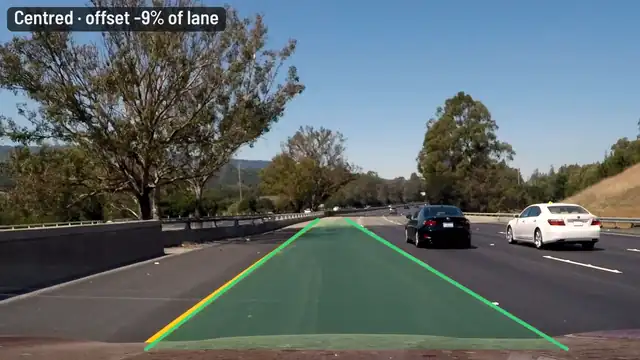

# 🛣️ Coding Activity 1 – Development of Lane Detection system for ADAS application

## 📝 Description

This activity focuses on the development of a Lane Detection system using Rust. The system utilizes the front camera feed of an ego vehicle to detect lanes on the road. Understanding the lanes is a critical component in various ADAS features like Lane Departure Warning, Lane Change Assist, and Lane Keep Assist among others.

## 🎯 Problem Statement

- Develop the system in Rust.
- Utilize computer vision techniques and any required machine learning or deep learning algorithms.
- Use a video from public datasets like KITTI, nuscenes, or others that have clear lane markings from a front camera perspective.
- Implement and validate the lane detection system.
- Continuously detect lanes in real-time on the video.

## 🛠 Technologies

- **Programming Language**: Rust
- **Computer Vision**: pure Rust ([image](https://crates.io/crates/image) + [imageproc](https://crates.io/crates/imageproc) for Canny, a banded Hough transform in `adas-core/src/lanes.rs`); no OpenCV
- **Machine Learning**: none needed; classic computer vision
- **Data Source**: [Udacity lane-lines test videos](https://github.com/udacity/CarND-LaneLines-P1) (MIT), via `scripts/fetch-data.sh`



## 📚 References

- [Tutorial: Real-time Lane Detection with OpenCV](https://www.analyticsvidhya.com/blog/2020/05/tutorial-real-time-lane-detection-opencv/)
- [Simple Lane Detection with OpenCV](https://medium.com/@mrhwick/simple-lane-detection-with-opencv-bfeb6ae54ec0)
- [Papers with Code: Lane Detection](https://paperswithcode.com/task/lane-detection/codeless)
- [ArXiv Paper on Lane Detection](https://arxiv.org/pdf/1903.02193.pdf)

## 🏁 Getting Started

```bash
./scripts/fetch-data.sh                                            # once
cargo run --release -p lane_detection                              # data/video.mp4 → output/lanes.mp4
cargo run --release -p lane_detection -- --input data/challenge.mp4 --debug --output output/challenge.mp4
```

`--debug` shows the edge map the detector works on. `--start`/`--duration` trim the clip.

### How it works

1. **Paint mask**: keep white and yellow pixels only, so asphalt texture, shadows and the concrete bridge in `challenge.mp4` do not produce edges.
2. **Canny edges** on the mask, inside a symmetric trapezoid **region of interest**.
3. **Banded Hough transform**: votes only for lane-like angles (left 14–76°, right 104–166°), so the horizon and the bonnet are ignored, then a vote-weighted average gives **one line per side**.
4. **Smoothing** between frames, and lines are **held through dashed gaps** for a few frames.
5. **Lane departure**: the car's offset from the lane centre, as a share of lane width. If only one line is visible, the remembered lane width fills in.

On the three Udacity clips both lanes are tracked in 100% of frames, at 10–18 fps on a laptop CPU.

### What changed from the first version

The OpenCV version needed a system OpenCV install plus libclang matching the `opencv` crate, and read `../data/video.mp4` relative to the current directory. It skipped the first frame, drew every raw Hough segment (including horizontal edges), used a lopsided ROI, and needed a desktop window to run.
