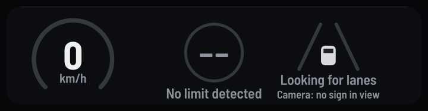

# 🎛 Coding Activity 6 – Instrument Cluster (GUI) Development 🎛

## 📝 Description

After successfully implementing various ADAS applications in the previous activities, this activity aims to bring them all together into a single instrument cluster. The goal is to display the outputs from all five previous coding activities in a well-designed GUI.

## 🎯 Problem Statement

- Develop the instrument cluster in Rust.
- You can choose from a variety of GUI libraries such as PyQT, Tkinter, wxwidget, or any other of your choice.
- Be imaginative and creative in designing a visually appealing GUI.
- Make sure to incorporate features to display the information from all the previous five coding activities.
- Test your implementation to ensure everything works as expected.

## 🛠 Technologies

- **Programming Language**: Rust
- **Rendering**: [tiny-skia](https://crates.io/crates/tiny-skia) (antialiased shapes) and [ab_glyph](https://crates.io/crates/ab_glyph) (text), into frames that can be saved as video, GIF or PNG
- **Font**: Barlow Semi Condensed (OFL), close to the DIN lettering of German road signs


  
## 🎨 Design References

Although an image reference is provided, you are free to design the instrument cluster according to your own ideas and creativity.

## 🏁 Getting Started

```bash
cargo run --release -p instrument_cluster                                   # output/cluster.gif
cargo run --release -p instrument_cluster -- --snapshot over.png --speed 66 --limit 50 --departure left
```

### What it shows

- **Speed** on a 0–160 km/h arc, with a red tick at the current limit. It turns amber when you are a little over and red when you are well over.
- **The speed limit in force** (the recognised sign), the cluster's centrepiece. It pops when a new limit is set and gets a pulsing halo when you are over.
- **Lane assist**: both lines green when tracked, the line you are drifting towards blinks amber, and the car icon nudges over.
- **What the camera sees right now**: the classifier's raw reading and confidence, before the tracker's voting.

Colours follow ISO 2575 telltale conventions: green = active, amber = caution, red = warning. The cluster is drawn by `adas-core/src/cluster.rs`, and Activity 7 uses the same code live.
