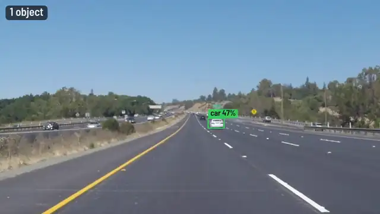
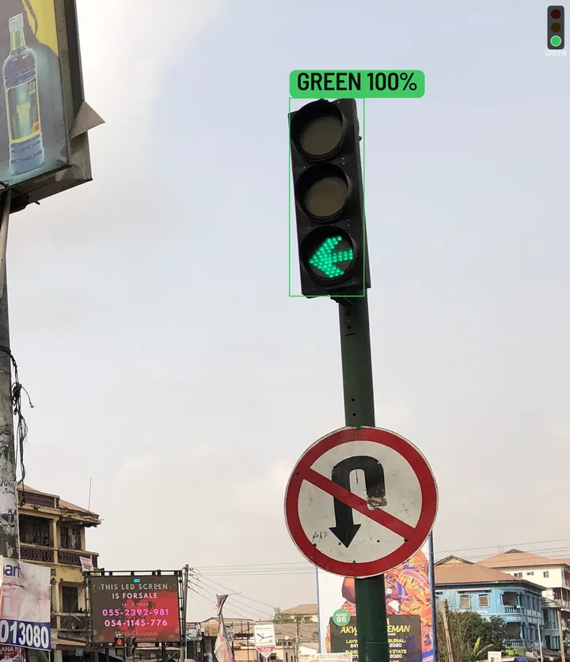

# ADAS Projects in Rust


A Cargo workspace that works through seven ADAS coding activities in Rust, from
lane detection to an instrument cluster, and finishes by running all of them
together on a dashcam clip. Inference runs ONNX models through
[tract](https://github.com/sonos/tract), image processing uses `image` and
`imageproc`, and video goes in and out through `ffmpeg`. There is no OpenCV and
no Python anywhere.

## About

This is my working-through of the coding activities from an
[ADAS course on Udemy](https://www.udemy.com/course/advanced-driver-assistance-systems/),
reimplemented in Rust. ADAS covers the systems that watch the road and step in
when a driver cannot: lane keeping, sign and speed-limit recognition, object and
traffic-light detection. That makes both performance and safety non-negotiable,
which is why I used Rust throughout — the speed of C with the memory safety the
domain needs.

## Quick start

You need Rust 1.82+ and `ffmpeg`.

```bash
./scripts/fetch-data.sh                                         # dashcam clips + YOLOX models → data/
cargo run --release -p adas_drive                               # everything together → output/drive.mp4
cargo run --release -p lane_detection -- --debug                # Activity 1 → output/lanes.mp4
cargo run --release -p traffic_sign_recognition                 # Activity 2: accuracy on data/Test
cargo run --release -p speed_limit_recognition -- --demo        # Activity 3: limit tracking, no data needed
cargo run --release -p object_detection                         # Activity 4: YOLOX → output/detect.mp4
cargo run --release -p street_light_detection -- --preset nano  # Activity 5: traffic lights
cargo run --release -p instrument_cluster                       # Activity 6 → output/cluster.gif
cargo test --workspace
```

Every binary takes `--help`. Outputs can be `.mp4`, `.webm`, `.webp` (small
animations), `.gif`, or a folder of PNGs.

## Activities

| # | Activity | What it does | Binary |
|---|---|---|---|
| 1 | [Lane Detection](./Activity1-Lane-Detection/README.md) | lane fitting and departure warning | `-p lane_detection` |
| 2 | [Traffic Sign Recognition](./Activity2-Traffic-Sign-Recognition/README.md) | GTSRB CNN, 98% on the bundled test images | `-p traffic_sign_recognition` |
| 3 | [Speed Limit Recognition](./Activity3-Speed-Limit-Recognition/README.md) | multi-frame confirmation of the limit in force | `-p speed_limit_recognition` |
| 4 | [Object Detection](./Activity4-Object-Detection/README.md) | YOLOX (ONNX + tract) with an ADAS class filter | `-p object_detection` |
| 5 | [Street Light Detection](./Activity5-Street-Light-Detection/README.md) | traffic-light boxes and RED / AMBER / GREEN / OFF | `-p street_light_detection` |
| 6 | [Instrument Cluster](./Activity6-Instrument-Cluster/README.md) | speed, limit, lane assist and camera read-out | `-p instrument_cluster` |
| 7 | [Integration](./Activity7-Integration/README.md) | lanes, detection, signs, signals and cluster on one clip | `-p adas_drive` |

## Demo clips

The animation at the top of this page is Activity 7. Two of the newer activities
on their own:

|  |  |
|---|---|
| Object detection (Activity 4) | Traffic-light colour (Activity 5) |

## Layout

```text
adas-core/            shared library, used by every activity
  lanes.rs            paint mask → Canny → ROI → banded Hough → smoothing → departure
  classifier.rs       GTSRB CNN (ONNX) run by tract, pure Rust
  detector.rs         YOLOX object detection (ONNX) run by tract
  coco.rs             the 80 COCO class names + the driving-relevant subset
  traffic_light.rs    traffic-light colour: RED / AMBER / GREEN / OFF
  speed.rs            speed-limit tracker: votes over frames, "end of limit" signs
  cluster.rs          the instrument cluster
  render.rs           drawing (tiny-skia), text (ab_glyph), German road signs
  video.rs            video in/out through ffmpeg, or image folders
Activity*/            one small binary each
data/                 model, 51 GTSRB test images + labels, downloaded clips and YOLOX models
```

## Technologies

- **Language**: Rust (one Cargo workspace, `Cargo.lock` committed)
- **Inference**: [tract](https://github.com/sonos/tract) runs the Keras CNN and YOLOX, from ONNX, in pure Rust
- **Detection**: [YOLOX](https://github.com/Megvii-BaseDetection/YOLOX) (Apache-2.0) for Activities 4 and 5
- **Image processing**: [image](https://crates.io/crates/image), [imageproc](https://crates.io/crates/imageproc) (Canny), a small custom Hough transform
- **Drawing**: [tiny-skia](https://crates.io/crates/tiny-skia), [ab_glyph](https://crates.io/crates/ab_glyph) with Barlow Semi Condensed (OFL)
- **Video**: the `ffmpeg` command-line tool
- **Data**: [GTSRB](https://benchmark.ini.rub.de/) traffic signs; dashcam clips from [Udacity's lane-lines project](https://github.com/udacity/CarND-LaneLines-P1) (MIT)

## Accuracy and limitations

The sign classifier is a small CNN trained on GTSRB photos. On the 51 bundled
GTSRB test images it gets **50/51 (98%)**, and 21/21 on photographed German
signs. Two caveats, both handled in the code:

- **It is ~100% confident even when wrong**, so a speed limit only changes when
  several frames agree *and* the winner clearly beats the runner-up. If readings
  flip-flop the old limit stays: missing a sign is safer than switching to a
  wrong one.
- **It generalises unevenly to synthetic signs.** Run
  `cargo run --release -p adas-core --example sign_probe`: it reads rendered 20,
  30, 70 and 80 signs reliably, 120 mostly, and 50, 60 and 100 poorly. The drive
  demo's default route uses signs it can read.

YOLOX-Nano, used for object detection and to locate traffic lights, is the
smallest model in the family. It runs at roughly 40 ms per frame on a CPU and
occasionally mistakes a bright billboard for a traffic light; `--preset tiny` or
`--preset s` reduce those false positives at the cost of speed.

## Licence

This project is licensed under the [MIT License](./LICENSE). The Barlow font is
under the SIL Open Font License (`assets/fonts/OFL-Barlow.txt`). The sample clips
are © Udacity, MIT licence.
