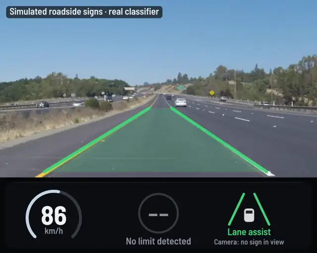

# 🚗 ADAS Projects In Rust 🦀



## Introduction

Welcome to my repository dedicated to Advanced Driver Assistance Systems (ADAS)! I've recently completed an [ADAS course on Udemy](https://www.udemy.com/course/advanced-driver-assistance-systems/), and I'm excited to share my journey implementing these critical systems using Rust. Why Rust? It offers both performance and safety, essential attributes when we're talking about systems that can save lives on the road.

## 🎯 Motivation

The world is shifting towards automation and intelligent systems, and the automotive industry is no exception. Advanced Driver Assistance Systems (ADAS) have a profound impact on safety and driving experience. Having specialized in embedded systems and AI in the ADAS division, I see the immense potential and challenges in this field. I chose Rust to push the boundaries of what's possible in terms of performance, safety, and code quality.

## 🚀 Quick Start

You need Rust 1.82+ and `ffmpeg` (for reading and writing video). No OpenCV, no Python, no system libraries.

```bash
./scripts/fetch-data.sh                                         # dashcam clips + YOLOX models → data/
cargo run --release -p adas_drive                               # everything together → output/drive.mp4
cargo run --release -p lane_detection -- --debug                # Activity 1 → output/lanes.mp4
cargo run --release -p traffic_sign_recognition                 # Activity 2: accuracy on data/Test
cargo run --release -p speed_limit_recognition -- --demo        # Activity 3: limit tracking, no data needed
cargo run --release -p object_detection                         # Activity 4: YOLOX → output/detect.mp4
cargo run --release -p street_light_detection -- --preset nano  # Activity 5: traffic lights
cargo run --release -p instrument_cluster                       # Activity 6 → output/cluster.gif
cargo test --workspace
```

Every binary takes `--help`. Outputs can be `.mp4`, `.webm`, `.webp` (small animations), `.gif`, or a folder of PNGs.

## 📚 Outline

| | Activity | Status | Run |
|---|---|---|---|
| 1 | [Lane Detection](./Activity1-Lane-Detection/README.md) | ✅ lanes + departure warning | `-p lane_detection` |
| 2 | [Traffic Sign Recognition](./Activity2-Traffic-Sign-Recognition/README.md) | ✅ 98% on the bundled GTSRB test images | `-p traffic_sign_recognition` |
| 3 | [Speed Limit Recognition](./Activity3-Speed-Limit-Recognition/README.md) | ✅ multi-frame confirmation | `-p speed_limit_recognition` |
| 4 | [Object Detection](./Activity4-Object-Detection/README.md) | ✅ YOLOX (ONNX + tract) | `-p object_detection` |
| 5 | [Street Light Detection](./Activity5-Street-Light-Detection/README.md) | ✅ traffic-light colour | `-p street_light_detection` |
| 6 | [Instrument Cluster Development](./Activity6-Instrument-Cluster/README.md) | ✅ rendered cluster | `-p instrument_cluster` |
| 7 | [Integration of All Systems](./Activity7-Integration/README.md) | ✅ lanes + signs + cluster on video | `-p adas_drive` |

## 🏗 How it fits together

```
adas-core/            shared library, used by every activity
  lanes.rs            paint mask → Canny → ROI → banded Hough → smoothing → departure
  classifier.rs       GTSRB CNN (ONNX) run by tract, pure Rust
  detector.rs         YOLOX object detection (ONNX) run by tract
  coco.rs             the 80 COCO class names + the driving-relevant subset
  traffic_light.rs    traffic-light colour: RED / AMBER / GREEN / OFF
  speed.rs            speed-limit tracker: votes over frames, "end of limit" signs
  cluster.rs          the instrument cluster
  render.rs           drawing (tiny-skia), text (ab_glyph), German road signs
  video.rs            video in/out through ffmpeg, or image folders
Activity*/            one small binary each
data/                 model, 51 GTSRB test images + labels, downloaded clips and YOLOX models
```

## ⚙ Technologies

- **Language**: Rust (one Cargo workspace, `Cargo.lock` committed)
- **Inference**: [tract](https://github.com/sonos/tract) runs the Keras CNN *and* YOLOX, from ONNX, in pure Rust
- **Detection**: [YOLOX](https://github.com/Megvii-BaseDetection/YOLOX) (Apache-2.0) for Activities 4 and 5
- **Image processing**: [image](https://crates.io/crates/image), [imageproc](https://crates.io/crates/imageproc) (Canny), a small custom Hough transform
- **Drawing**: [tiny-skia](https://crates.io/crates/tiny-skia), [ab_glyph](https://crates.io/crates/ab_glyph) with Barlow Semi Condensed (OFL)
- **Video**: the `ffmpeg` command-line tool
- **Data**: [GTSRB](https://benchmark.ini.rub.de/) traffic signs; dashcam clips from [Udacity's lane-lines project](https://github.com/udacity/CarND-LaneLines-P1) (MIT)

## 📊 What the model can and cannot read

The classifier is a small CNN trained on GTSRB photos. On the 51 bundled GTSRB test images it gets **50/51 (98%)**, and 21/21 on photographed German signs. Two honest caveats, both handled in the code:

- **It is ~100% confident even when wrong**, so a speed limit is only changed when several frames agree *and* the winner clearly beats the runner-up. If readings flip-flop, the old limit stays: missing a sign is safer than switching to a wrong one.
- **It generalises unevenly to synthetic signs.** Run `cargo run --release -p adas-core --example sign_probe`: it reads rendered 20, 30, 70 and 80 signs reliably, 120 mostly, and 50, 60 and 100 poorly. The drive demo's default route uses signs it can read.

## 📃 License

This project is licensed under [MIT License](./LICENSE). The Barlow font is under the SIL Open Font License (`assets/fonts/OFL-Barlow.txt`). The sample clips are © Udacity, MIT licence.
